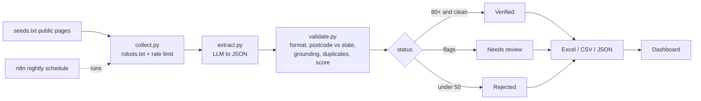

# ProviderIQ

**AI-assisted pipeline that turns messy public web pages about Australian healthcare providers into clean, verified, review-ready data.**

Built for the Gokul Infocare *AI Growth & Automation Associate* assessment (Task 1, Automation + Web Scraping & Data Intelligence). It is an independent prototype and is not affiliated with Gokul Infocare or its MIRA project.

## The problem
Collecting data on hospitals, clinics and practitioners by hand is slow, and AI extraction on its own can quietly invent phone numbers or services. ProviderIQ keeps the speed of AI and adds a verification layer, so a person only reviews what the system is unsure about.

## How it works


**The key idea is grounding.** Every value the AI returns (name, phone, email, suburb, postcode, services) must appear in the source page text. A value the model made up is flagged `ungrounded_*` and can never be auto-verified.

Other checks: Australian phone formats, email syntax, postcode-to-state consistency (e.g. VIC with postcode 2000 is flagged), fuzzy duplicate detection, and a 0-100 quality score.

## Quick start (no API key needed)
```bash
pip install -r requirements.txt
PYTHONPATH=src python tests/test_validate.py                 # 6 tests
PYTHONPATH=src python -m provideriq.pipeline --extractor mock-llm
```
This runs on 5 **fictional** sample pages in `samples/` and writes `outputs/providers.xlsx`, `.csv` and `.json`. Open `dashboard/index.html` through any static server (`python -m http.server` inside `dashboard/`) to browse results.

`mock-llm` simulates a model that invents a phone number and two services for one page, to show the verifier catching it. It is a demonstration, not a real model.

## Run on real data
1. Copy `.env.example` to `.env`, choose `gemini` or `anthropic`, add your key (and for Anthropic, `ANTHROPIC_MODEL`). Check current model names in the provider's docs.
2. Add public page URLs you are allowed to access to `seeds.txt`.
3. `python -m provideriq.collect` then `PYTHONPATH=src python -m provideriq.pipeline --source data/raw --extractor gemini`
4. Copy `outputs/providers.json` into `dashboard/` to refresh the dashboard.

## Automation
`n8n/provideriq_workflow.json` runs the pipeline nightly and emails a reviewer when records need attention. Import it in n8n and edit the path and email addresses.

## Deploy the dashboard
Upload the `dashboard/` folder to GitHub Pages, Vercel or Netlify (it is plain static HTML).

## Responsible data use
- Only publicly listed business details; no patient data.
- Respects `robots.txt` (and skips a site if it cannot be read), rate-limits requests, and identifies itself with a contact address.
- Check each site's terms before collecting; many directories prohibit scraping.
- Any outreach built on this data must follow the Spam Act 2003 and the Privacy Act 1988.

## Limits (honest)
- Sample pages are fictional; the bundled results demonstrate the workflow, not real providers.
- Postcode ranges are approximate; some postcodes span states.
- Grounding checks that a value is present in the page, not that the page itself is correct.
- LLM prompt accuracy numbers must be measured on your own real pages (see `docs/PROMPTS.md`).

## Role fit
| Job asks for | ProviderIQ shows |
|---|---|
| Scrape and organise public data on doctors, nurses, hospitals | `collect.py`, schema, Excel export |
| Python and AI automation for healthcare workflows | pipeline + n8n workflow |
| Evaluate AI output, verify facts | grounding, cross-checks, review queue, tests |
| Websites and digital marketing | dashboard; extend with outreach drafts |
